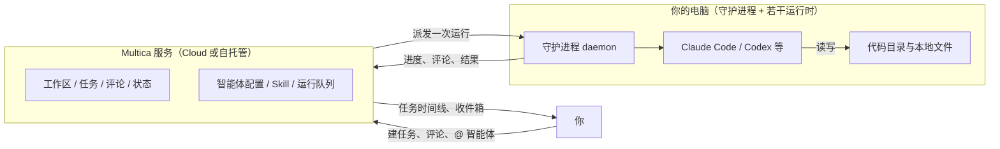
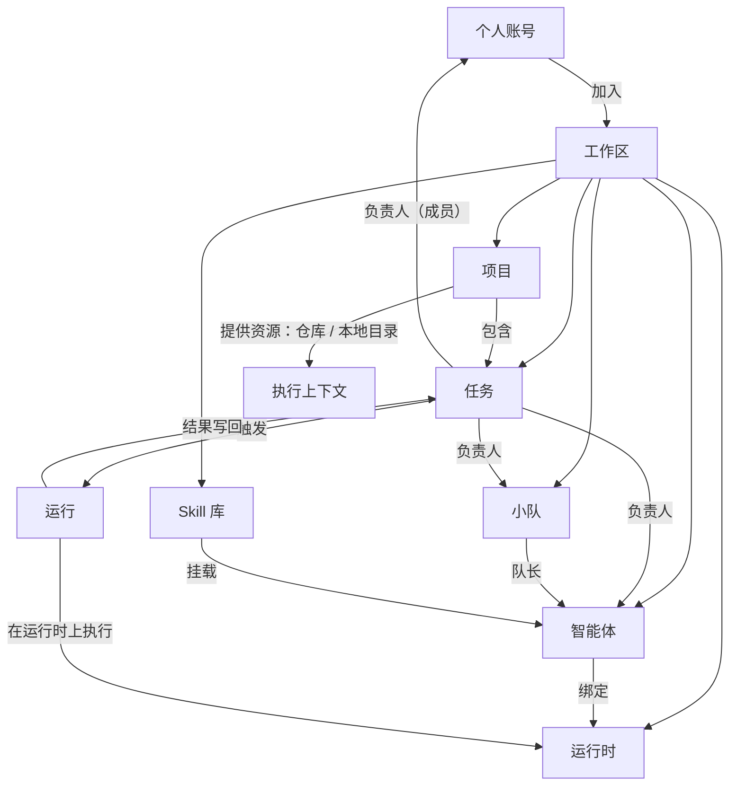
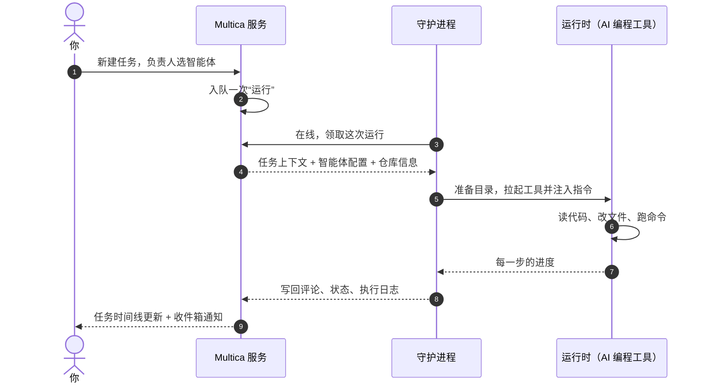
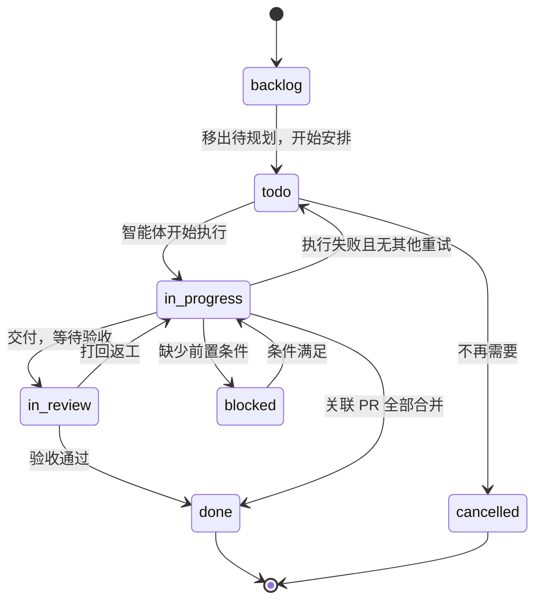
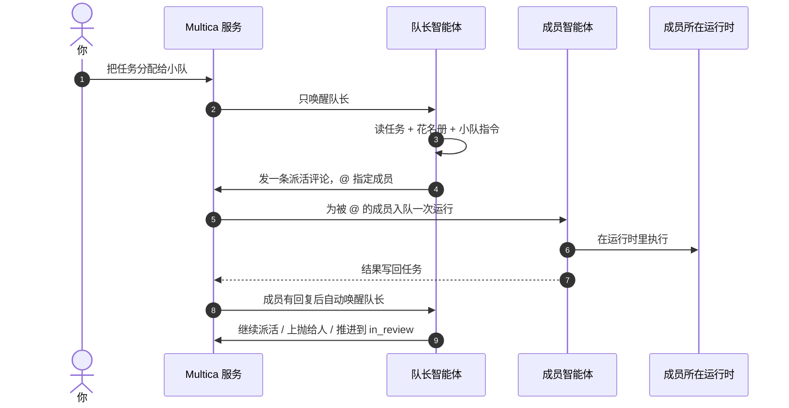

# Multica 入门教程：从部署到看懂它的协作模型

> 首发于：2026-11-01
>
> 注：本文部分内容由 AI 生成。

## 前言

过去一年，我写代码的日常基本都搬进了终端里的 AI 编程工具：Claude Code、Codex 这类东西，让“描述一段需求 → 它读仓库、改文件、跑命令”变成了习惯。但用得越久，问题越明显：

- 一次对话就是一次上下文，聊完关掉，做过什么只能靠回忆；
- 同时推进几件事时，几段对话会互相踩文件、互相打架；
- 想让“调研、实现、审查”分开交给不同的角色，只能靠自己记着该轮到谁。

Multica 补的就是这层缺口。它的定位可以用一句话说清：**Multica 记录并协调工作，连接的电脑负责执行。** 它不替你跑模型，也不托管你的代码，而是把“让 AI 干活”从一次性的对话，变成一条有状态、有记录、可追溯的任务。

这篇教程写给刚接触 Multica 的人，读完应该能做到两件事：

1. 跟着步骤把自己的 Multica 跑起来，完成第一次“人 → 任务 → 智能体 → 结果”的闭环；
2. 看懂它内部每个对象分别是什么、彼此是什么关系、一次任务是怎么流转起来的。

> 说明：本文基于 Multica 官方文档与 CLI 的实际行为整理，示例以“自托管 + Claude Code”为主线，换其他 AI 编程工具思路完全一样。

## 一、Multica 是什么

### 1.1 它解决的问题

先说结论：Multica 解决的不是“模型够不够聪明”，而是**“AI 干完的活怎么被管理”**。具体是三个痛点：

**第一，工作没有载体。** 对话式编程里，需求、约束、讨论、结果全在聊天记录里。换台机器、过一周再回来看，只剩下一个模糊的印象。Multica 把每件事变成一条任务（Issue）：描述、评论、状态、执行日志、产物都挂在同一条任务上。

**第二，执行不落地。** 很多“AI 工作流”产品是把工具放在云上跑，你的代码得先上传。Multica 反着来：执行永远发生在你自己连的那台电脑上，用的是你已经装好、已经登录的 AI 编程工具，读的是你本地的代码目录。

**第三，人多、智能体也多之后，活分不出去。** 一条任务该给谁？一个人干不完要不要拆？重复的事能不能定时跑？这些问题靠“记得提醒自己”是撑不住的，Multica 用项目、小队和自动化来接管。

### 1.2 它不是什么

把边界说清楚，后面很多行为就顺了：

| 它不是 | 实际是 |
| --- | --- |
| 一个新的 AI 编程工具 | 调用你电脑上**已经装好的** Claude Code、Codex、Cursor 等工具 |
| 代码托管平台 | 代码始终在你的 GitHub 仓库或本地目录里 |
| 一个常驻运行的机器人 | 智能体只是一份配置，**被触发时才执行一次** |
| 把你从电脑前解放出来的纯云端服务 | 至少要有一台连着 AI 编程工具的电脑在线，运行才领得走 |

### 1.3 它适合谁

- **已经在用 AI 编程工具的个人开发者**：想把零散对话变成有记录的工作流；
- **一个人当一支队伍用的独立开发者**：想让“实现、审查、调研”分成不同角色，还能互相接力；
- **需要 AI 产出可追溯的小团队**：谁在什么时候让它做了什么，任务时间线里都有；
- **有数据合规要求、想自托管的人**：服务端可以自己用 Docker Compose 跑。

反过来说，如果你还没装任何 AI 编程工具，或者要的是“网页上填个需求、云端全自动出结果”，那 Multica 不是那个东西——它更像把你现有的工具**组织**起来的那一层。

### 1.4 数据与执行的边界

这是理解 Multica 最重要的一张图：服务端负责记录与协调，你的电脑负责执行。



记住这条边界，后面两个高频疑惑就有答案了：

- **“为什么我的运行一直在排队？”** —— 执行电脑上的运行时不在线，运行就只能等着；
- **“模型调用算谁的钱、谁的额度？”** —— 算你 AI 编程工具账号的，Multica 只是把工具拉起来。

有一个例外值得知道：智能体的 `custom_env`（自定义环境变量）会保存在 Multica 服务端，执行时再传给运行时。真正不该离开本机的密钥，不要写进这里。

## 二、快速配置部署

部署前先建立一个认知：Multica 分**两块**，它们可以在一台机器上，也可以分开。

| 部分 | 跑什么 | 放在哪 |
| --- | --- | --- |
| Multica 服务 | Web、API、PostgreSQL | 一台装了 Docker 的机器（用 Cloud 时就是 multica.ai） |
| 执行电脑 | 守护进程 + AI 编程工具 | 你实际写代码的那台电脑 |

### 2.1 两条路线怎么选

| | Multica Cloud | 自托管 |
| --- | --- | --- |
| 服务端 | 官方托管，注册即用 | 自己用 Docker Compose 起 |
| 适合 | 想最快跑通、不介意数据在云端 | 数据要自己拿、要内网部署 |
| 首次跑通耗时 | 几分钟 | 十分钟到一个小时（看 Docker 镜像下载速度） |

> 两条路线只差在**服务端**：执行电脑都是你自己的那台，跑的还是你已登录的 AI 编程工具。

**如果你只是想先体验，选 Cloud；如果你是“代码和数据都不想出门”的类型，直接跳 2.3 自托管。**

### 2.2 路线 A：Cloud（最快）

1. 打开 [multica.ai](https://multica.ai) 注册并登录；
2. **创建工作区**：填名称和工作区 URL 里的 slug（例如 `multica.ai/my-team` 里的 `my-team`，创建后不可改）；
3. **连接执行电脑**：装 [Multica Desktop](https://multica.ai/download) 并登录，守护进程会把这台电脑接入 Multica，并检测本机已经装好的 AI 编程工具——**每款工具注册成一个运行时**；
4. 打开侧边栏 **AI 团队 → 运行时**，确认列表里是 `Claude (你的主机名)` 这样的工具级条目，并且在线；
5. 接下来直接看 2.4“跑通第一个闭环”。

> 不想装 Desktop 也行：在运行时页面点 **添加 → 其他机器或服务器**，按提示在那台机器上装 CLI、起守护进程，效果一样。

### 2.3 路线 B：自托管（Docker Compose）

#### 环境要求

运行服务的那台机器需要：

- Docker Engine 或 Docker Desktop，且 `docker compose`（Compose v2）可用；
- `git`、`make`、`curl`、`openssl`；
- 本机 `3000`、`8080` 端口没被占用。

先确认一下：

```bash
docker info
docker compose version
```

#### 第一步：启动服务

```bash
git clone --depth 1 https://github.com/multica-ai/multica.git
cd multica
make selfhost
```

`make selfhost` 会拉取**已发布的镜像**并起容器，不会编译当前 checkout 里的代码。再次运行时，它会继续用现有的 `.env` 和数据卷，不会重新生成密钥。

#### 第二步：确认服务就绪

```bash
# 容器状态：postgres 应为 healthy，backend / frontend 在运行
docker compose -f docker-compose.selfhost.yml ps

# 后端、数据库、migration 的健康检查
curl -fsS http://localhost:8080/readyz
```

正常返回：

```json
{"status":"ok","checks":{"db":"ok","migrations":"ok"}}
```

migration 是 backend 容器启动时自动跑的，不需要手动执行。

#### 第三步：登录并建工作区

浏览器打开 `http://localhost:3000`，输入邮箱获取验证码。

**默认没有配置邮件服务**，验证码要自己去 backend 日志里取：

```bash
docker compose -f docker-compose.selfhost.yml logs backend | grep "Verification code"
```

日志里会出现类似 `[DEV] Verification code for you@example.com: 123456` 的内容，填进去，然后创建第一个工作区。

> 关于验证码有两个容易搞反的点：`MULTICA_DEV_VERIFICATION_CODE`（固定验证码）只在开发环境生效，`make selfhost` 默认的 `APP_ENV=production` 下它会被忽略；但没配 SMTP / Resend 时，验证码本来就打在 backend 日志里——**谁能看日志，谁就能登录**，所以生产环境该把邮件服务配上。

#### 第四步：把执行电脑接进来

下面的命令在**装了 AI 编程工具的那台电脑**上执行，不一定是跑 Docker 的那台。

先装 Multica CLI（macOS / Linux 用官方安装脚本，Windows 上按官方文档的安装方式，或者干脆用 Desktop 客户端，它会顺带把运行时装好）：

```bash
curl -fsSL https://raw.githubusercontent.com/multica-ai/multica/main/scripts/install.sh | bash
```

服务端就在本机时：

```bash
multica setup self-host
```

服务端在另一台机器时，传入两个地址：

```bash
multica setup self-host \
  --server-url https://api.example.com \
  --app-url https://app.example.com
```

这条命令会先探测 `<server-url>/health`，再打开浏览器完成登录，最后保存凭据并启动守护进程。然后验证：

```bash
multica daemon status
```

正常应该看到 `Daemon: running`、`Agents` 里包含本机检测到的 AI 编程工具、`Workspaces` 大于 0。

#### 常见坑

- **`multica setup` 报 server is not reachable**：多半是反向代理没把 `/health` 路由到 backend，其次才是 DNS、TLS、防火墙、超时；
- **登录收不到验证码**：默认没配邮件服务，去 backend 日志里翻；
- **想清空重来**：`docker compose -f docker-compose.selfhost.yml down` 会保留 `pgdata` 和 `backend_uploads` 数据卷；加了 `-v` 才会连数据库一起删掉，这一条要谨慎。

#### 常用管理命令

```bash
docker compose -f docker-compose.selfhost.yml ps          # 状态
docker compose -f docker-compose.selfhost.yml logs -f backend  # 日志
docker compose -f docker-compose.selfhost.yml up -d       # 应用 .env 变化
docker compose -f docker-compose.selfhost.yml down        # 停止，保留数据卷
```

### 2.4 跑通第一个闭环

不管走哪条路线，接下来这四步都是一样的。

#### 第一步：建一个智能体

打开 **AI 团队 → 智能体 → 新建智能体**，先选运行时（一个运行时对应一款 AI 编程工具），然后填三样：

| 字段 | 填什么 |
| --- | --- |
| 名称 | 例如 `博客助手` |
| 模型 | 该工具支持的模型里选一个 |
| 指令 | 它负责什么、不负责什么、输出要求 |

指令是智能体的“人格 + 工作合同”，比你想象的重要，先给个能用的：

```text
你是我的博客写作助手。

你负责：根据我给出的主题和素材，写出适合 VitePress 博客的中文技术文章；
文章要结构清晰、有示例、涉及流程和层级时用 Mermaid 表达。

你不负责：不要修改仓库里的其他文件；不要发布或部署站点；
不要在正文里写内部路径和凭据。

完成后用一段话总结你做了什么，并列出改动的文件。
如果需求有歧义，先问我再动手。
```

其余字段保持默认即可。注意：**新智能体默认只有创建者能运行**，需要协作时再去 Access 里放开。

#### 第二步：建第一条任务

点侧边栏 **新建任务**（快捷键 `C`），把负责人选成刚才那个智能体，描述里写清三件事：

- **目标**：要交付什么；
- **边界**：不能碰什么、必须遵守什么；
- **验收**：怎么算做完。

例如：

```text
在仓库里新增一篇文章，主题是“Multica 入门”，放在 article/ai/ 下。

要求：
- 面向第一次接触 Multica 的读者，讲清它是什么、怎么部署、内部对象怎么协作
- 涉及流程和层级的地方用 Mermaid 图表达
- 新增的页面要加进 .vitepress/config.mts 的侧边栏

验收：本地 pnpm docs:build 能通过，侧边栏能点进新文章。
不要部署，也不要改其他文章。
```

任务不在 `backlog` 状态时，分配给智能体会**立即入队一次运行**；运行时不在线就先排队。

#### 第三步：看执行日志，别只看结果

任务右侧的执行日志里，能看到这次运行的每一步：模型说了什么、跑了哪些命令、读了哪些文件、改了哪些文件。排查“它为什么这么做”时，这里是唯一的一手材料。

#### 第四步：验收与打回

执行结束后，智能体一般会把任务状态推到 `in_review`，并在评论里说明做了什么。你可以：

- 直接在评论里追问、补充要求，它会再来一轮；
- 不满意就改回 `in_progress` 或加评论打回。

**判断闭环成功的标准**：执行日志显示“已完成” + 任务时间线里出现智能体的评论。注意“运行已完成”只代表这一次执行结束，**不代表任务做完了**。

### 2.5 CLI 速查

Web 上能做的事，CLI 基本都能做，排查问题时尤其好用：

| 想看什么 | 命令 |
| --- | --- |
| 守护进程在不在线 | `multica daemon status` |
| 有哪些运行时 | `multica runtime list` |
| 工作区里的智能体 | `multica agent list` |
| 任务列表 / 详情 | `multica issue list` / `multica issue get <issue-id>` |
| 这次执行发生了什么 | `multica issue runs <issue-id>` |
| 工作区仓库 | `multica repo list` / `multica repo add <url>` |
| 小队 | `multica squad list` |
| 自动化 | `multica autopilot list` |

## 三、七个核心对象：分别是什么

部署跑通之后，回到概念层。Multica 的对象不多，但第一次看容易乱，先用一张表建立整体印象：

| 对象 | 一句话定位 | 和谁有关系 |
| --- | --- | --- |
| 个人（用户） | 登录身份的载体，一个账号可以属于多个工作区 | 工作区成员、权限角色 |
| 工作区 | 团队共同工作的独立范围，一切都在里面 | 任务、项目、智能体、小队、运行时 |
| 任务（Issue） | 一项工作 + 它的讨论、状态和历史，日常工作的基本单位 | 负责人（成员 / 智能体 / 小队）、项目 |
| 项目 | 把相关任务组织在同一目标下，并提供共享的执行上下文和资源 | 任务、仓库 / 本地目录、工作流 |
| 小队 | 一名队长 + 若干成员，负责把活分给合适的人 | 队长智能体、成员智能体 / 成员 |
| 智能体 | 一份可复用的配置：身份、指令、模型、Skill、Access、运行时 | 运行时、任务、Skill |
| 运行时 | 真正执行的地方：一款已经接入 Multica 的 AI 编程工具（连同它所在的电脑） | 守护进程、智能体 |

下面逐个展开。

### 3.1 个人（用户）

个人是身份层：你注册一个账号，然后可以加入一个或多个工作区。在 Multica Cloud 上，这个账号属于 multica.ai；自托管时，它就是你这个实例里的账号。

个人在**某个工作区里**会有一个角色（owner / admin / member），权限影响的是“你能运行哪个智能体、能不能分配某个小队、能不能改工作区设置”。这一点在团队协作时最容易踩：智能体默认是私有的，别人看不见、也分配不了。

### 3.2 工作区

工作区是**一切的容器**：任务、项目、智能体、小队、运行时都在某个工作区里，人和智能体在同一个工作区里协作。它也是配置的边界：

- 任务编号前缀（例如 `MUL-123`、`CLAR-3`）；
- 任务状态、自定义属性；
- Skill 库、MCP 库；
- 代码仓库注册表。

换个工作区，等于换了一个独立的“公司/项目空间”，数据互不相通。

### 3.3 任务（Issue）

任务是 Multica 里安排工作的基本单位。一项功能、一个 bug、一次调研，只要需要有人（或智能体）负责推进，就可以建一条任务。它包含：

| 内容 | 用途 |
| --- | --- |
| 标题和描述 | 目标、背景、要求、验收条件 |
| 状态与优先级 | 现在处在哪个阶段、先做哪个 |
| 负责人 | 工作区成员、智能体，或小队 |
| 项目 / 父子关系 | 归属更大的目标，或拆成子任务 |
| 评论与执行日志 | 讨论过程、每次运行做了什么 |
| 产物 | 评论里上传的文件；同名同类型的文件再次上传，算同一份产物的新版本 |

有三点必须记牢：

1. **负责人决定“谁来干”**。成员 → 只做跟进，不触发运行；智能体 → 立即入队一次运行；小队 → 交给队长去分配。
2. **一个任务可以多次运行**。第一次实现、补充修改、再检查，都是同一条任务下的多次运行。
3. **运行结束 ≠ 任务完成**。任务是否完成，只看它的状态。

任务可以拆子任务，子任务还能设置阶段（stage），按 1、2、3 分批推进；某一阶段全部完成时，父任务的负责人会被唤醒，决定要不要推进下一阶段。

### 3.4 项目

项目解决的是“一条任务说不清”的工作：一次产品发布、一次迁移、一个需要多个角色接力的大功能。它的关键作用是**提供共享的执行上下文**：

- **项目描述会进入项目内每次运行的上下文**——所有任务都适用的目标、技术边界、交付约定写在这里；
- **项目资源**（GitHub 仓库、指定电脑上的本地目录）决定智能体去哪拿代码、在哪个目录干活；
- **项目工作流**决定看板有哪些列、每一步交给谁，例如“实现交给工程师、审查交给审查员、验收交给人”。

几个容易误解的点：

- 一条任务最多属于一个项目，项目不复制任务；
- 项目进度按任务自动算：`进度 = 属于 done 或 closed 分类的任务数 ÷ 项目内全部任务数`，`cancelled` 也算“从项目里结束”；
- 项目状态和任务状态互不联动，所有任务完成，项目也不会自动变成 `completed`。

### 3.5 智能体

智能体是加入工作区的 AI 协作者，但它的本质是**一份配置**：

```text
智能体 = 名称 + 指令（instructions）+ 模型 + Skill + Access + 绑定的运行时
```

它不是一个常驻进程，只在被触发时执行一次。所以：

- 改指令，就是改它以后每次的行为，不用每次都“口头提醒”；
- `description` 只是列表里的一句简介，不进入执行；真正进执行的是 `instructions`；
- 智能体绑定到某个运行时，运行时不在线，它就跑不了；
- 智能体可以归档，归档后不能再被分配。

### 3.6 小队

小队由**一名队长智能体和若干成员**组成，成员可以是智能体，也可以是人。它的主要用途是：**在创建任务时还不知道该谁干的情况下，让队长来判断**——持续路由（比如自动巡检把任务指给小队）也是同一套用法。

关键机制（也是很多人误解的地方）：

- 把任务分配给小队，**不会同时唤醒所有成员**，只会唤醒**队长**；
- 队长拿到三个额外信息：小队工作规范、花名册（每个成员带可直接复制的 mention）、小队指令（你写的路由规则）；
- 队长通过一条评论 `@` 指定成员来派活，被 `@` 的智能体才会入队运行；
- 队长派完活就停，这条任务保持 `in_progress`；成员有回复后，队长被自动唤醒，决定继续派活、上抛给人，还是把任务推进到 `in_review`。

所以小队是**路由机制**，不是并发机制，也不会把多个智能体“合并”成一个更强的智能体。

### 3.7 运行时

运行时是执行真正发生的地方：**一款已经接入 Multica 的 AI 编程工具**（连同它所在的那台电脑）。智能体是身份，运行时是执行这个身份的具体工具——同一台电脑上装了 Claude Code 和 Opencode，列表里就是两个运行时。

- 电脑上跑着一个守护进程（daemon），它负责领取任务、准备目录、拉起 AI 编程工具、把结果写回；
- 守护进程会检测本机的 AI 编程工具，**一款工具注册成一个运行时**（列表里长这样：`Claude (你的主机名)`、`Opencode (你的主机名)`）；智能体绑定到其中一个；
- 运行时在线才会被唤醒领取；离线时任务排队等着，不会丢；
- 守护进程通常以某个系统用户的身份运行，**它能读写的东西，AI 就能读写**。所以官方建议用专用用户、容器或虚拟机来跑，而不是你的个人主账号。

### 3.8 还有几个对象，先混个脸熟

| 对象 | 作用 |
| --- | --- |
| 运行（Run） | 智能体的一次具体执行记录；一次触发产生一次运行，结果是写回任务的日志与评论 |
| Skill | 可复用的能力包：指令定义“你是谁”，Skill 说明“这类活怎么做”，可以挂给多个智能体共用 |
| 对话（Chat） | 不依附任务的交流，适合提问和快速试；每条消息触发一轮执行 |
| 收件箱 | 成员的通知中心；智能体不用收件箱 |
| 自动化（Autopilot） | 按时间表或外部事件自动触发，也可以手动跑一次 |

## 四、它们怎么流转配合

概念摆完了，接下来是真正重要的部分：这些东西是怎么转起来的。

### 4.1 全局关系图

先把所有对象摆到一张图上：



读图顺序建议：**工作区装下所有东西 → 任务靠负责人指向成员、智能体或小队 → 智能体绑定运行时 → 触发产生运行 → 运行把结果写回任务**。

### 4.2 一次运行的完整链路

这是 Multica 最核心的一条链路，分五步：



对应到文字：

1. **任务提供上下文**：任务保存工作说明和负责人，系统用这个智能体的指令、模型、Skill 和运行时配置来执行；
2. **服务端创建运行**：运行进入队列；没有在线运行时，它就在队列里等着；
3. **守护进程领取运行**：在线的守护进程领走后，用智能体绑定的那个运行时（对应的 AI 编程工具）执行；
4. **工具在本地执行**：读工作目录、跑命令、改文件；
5. **结果写回任务**：进度、评论、结果显示在任务时间线和执行日志里。

### 4.3 谁能让智能体开始工作

智能体不会自己启动，每次运行都由一个明确动作触发：

| 触发方式 | 适合的场景 | 特点 |
| --- | --- | --- |
| 分配任务 | 最常用：有明确交付物 | 负责人是智能体 → 立即入队；是成员 → 不触发 |
| 评论里 @ 智能体 | 追问、补充、让某个角色看一眼 | 只唤醒被 @ 的那一个，不改变负责人 |
| 对话（Chat） | 还没想清楚要做什么，先聊聊 | 每条消息触发一轮执行，不产生任务 |
| 自动化（Autopilot） | 定时（每天整理一次日报）、外部事件（webhook） | 可以建任务，也可以只跑一次 |
| 子任务阶段完成 | 多阶段的大任务 | 系统唤醒父任务负责人，决定是否推进下一阶段 |

### 4.4 任务状态怎么流转



几个特殊行为值得单独记：

- 任务停在 `backlog` 时，**即使分配给了智能体也不会开始**；移出 `backlog` 才会触发；
- 智能体默认“开始工作时改 `in_progress`、交付后改 `in_review`”，`done` 一般留给人；
- 如果项目配了工作流，状态只能在步骤里选；只有进入**配置了交接（handoff）**的那一步，才会自动换负责人；
- 任务的关联 PR 全部合并时，任务会按工作区设置自动变成 `done`（默认行为）；这一步是从**当前任意非终态**直接进 `done` 的，不限于 `in_review`。

### 4.5 小队是怎么派活的

把任务分配给小队之后，流程是这样的：



队长再触发的规则也值得知道，它决定了“为什么有时候队长会插话、有时候不会”：

| 事件 | 会唤醒队长吗 |
| --- | --- |
| 非小队成员（人、外部智能体）发评论 | 会 |
| 小队成员发进展，不带任何 @ | 会 |
| 评论里显式 @ 了智能体 / 小队 | 不会（只唤醒被 @ 的那一个，负责人不会被隐式唤醒） |
| 评论里 @ 了成员 / @all | 不会（这两者本身不给任何人入队，但会压掉“隐式唤醒负责人”那条兜底路径） |
| 队长自己发的评论 | 不会 |
| 评论里只有任务互链 | 会 |

实战建议：**任务范围明确时，直接分配给智能体，别绕小队**。小队只在“创建任务时确实不知道该谁干”时才划算——多一层协调，就多一轮运行。

### 4.6 上下文是怎么被带进执行的

很多人会好奇：智能体怎么知道该读哪个仓库、遵守哪些约定？答案是执行时的上下文由几层拼起来：

| 来源 | 提供什么 |
| --- | --- |
| 智能体指令 | 身份、职责边界、输出要求（每次都生效） |
| 模型 / Skill | 用哪个模型、挂载了哪些能力包 |
| 项目描述 | 这个项目所有任务共享的目标和约定 |
| 任务描述与评论 | 这一次具体要做什么、有什么补充 |
| 项目资源 | 去哪个仓库 checkout、或在哪个本地目录工作 |

仓库相关的执行链路上有个细节：执行时用的 `multica repo checkout` 是通过本地守护进程完成的，不是直接连 GitHub。任务和 PR 的关联有两条路：**任务编号出现在 PR 标题或分支名里**（例如 `MUL-123`），或者编号紧跟 `Closes` / `Fixes` / `Resolves` 这类 closing 关键字（标题、正文都行）。正文里孤零零提一句编号是不关联的，所以写任务描述时顺手要求一句“PR 标题带上任务编号”，最省事。

### 4.7 再看一眼边界

回到那张边界图，把它当作排查清单：

| Multica 服务端 | 你的电脑 |
| --- | --- |
| 工作区、任务、评论、状态 | AI 编程工具及其登录凭据 |
| 智能体配置、Skill | 代码目录和本地文件 |
| 运行状态、执行记录、结果 | 实际的文件修改与命令执行 |

所以：

- 运行一直排队 → 先看守护进程和运行时在不在线（`multica daemon status`、`multica runtime list`）；
- 智能体改错文件 → 去执行日志里看是哪一步，再改它的指令，而不是每次都口头纠正；
- 担心密钥 → 别放进 `custom_env`，它存在服务端。

## 五、上手之后的几条建议

1. **任务描述写“意图 + 边界 + 验收”，不要写实现步骤。** 实现方式留给智能体，你负责把“做成什么样”说清楚。
2. **把纠正写进指令。** 同一个问题出现第二次，就说明该改智能体的 `instructions` 了，这比每次口头提醒有效得多。
3. **分清三种触发方式。** 有明确交付物 → 分配任务；只想让它看一眼 → 评论 @；还没想清楚 → 对话。
4. **自托管时注意权限边界。** 守护进程以哪个用户跑，AI 就能动那个用户能动的所有文件；用专用账号或容器更稳妥。
5. **先跑通最小闭环，再谈自动化。** 一条任务、一个智能体、一次成功的执行，比先配一堆自动化更能暴露问题。

## 六、小结

最后用三句话收个尾：

- **Multica 是“工作记录与协调层”**：它管理任务、智能体和运行时，真正干活的是你电脑上的 AI 编程工具；
- **部署分两块**：服务端（Cloud 或 Docker Compose 自托管）+ 执行电脑（守护进程 + 已登录的 AI 工具），缺一块运行就转不起来；
- **流转有一条主干**：任务靠负责人指向智能体或小队 → 触发产生运行 → 运行时执行 → 结果写回任务 → 人验收并推进状态。

理解了这条主干，剩下的项目、Skill、自动化，都只是在这条主干上加东西。

## 参考资料

- Multica 官方文档：[核心概念](https://multica.ai/docs/zh/concepts)、[Multica 的工作方式](https://multica.ai/docs/zh/how-multica-works)
- [自托管快速上手](https://multica.ai/docs/zh/self-host-quickstart)、[任务](https://multica.ai/docs/zh/issues)、[项目](https://multica.ai/docs/zh/projects)、[小队](https://multica.ai/docs/zh/squads)
- 开源仓库：[github.com/multica-ai/multica](https://github.com/multica-ai/multica)
